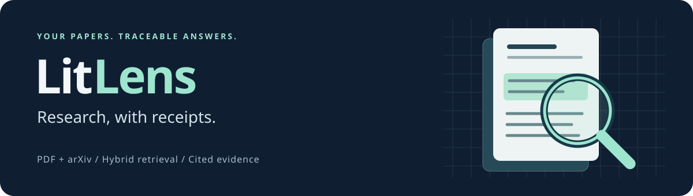
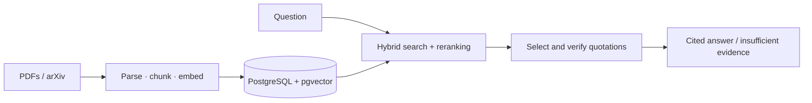

<p align="center">
  
</p>

<p align="center">
  A local research assistant for PDFs and arXiv papers.<br>
  Find relevant passages. Ask questions. Follow every citation back to its source.
</p>

<p align="center">
  <a href="#quickstart">Quickstart</a> ·
  <a href="docs/demo.md">Demo</a> ·
  <a href="docs/api.md">API reference</a> ·
  <a href="docs/architecture.md">Architecture</a> ·
  <a href="docs/evaluation.md">Evaluation</a>
</p>

# LitLens

LitLens brings PDF ingestion, hybrid search, and cited answers into a local FastAPI backend and Typer CLI.
PostgreSQL with pgvector stores the evidence; background workers handle parsing and embedding.

> **No model credentials needed to get started.**
> The default uses deterministic hash embeddings and verified source quotations.
> Ollama and hosted OpenAI-compatible providers are optional.
> This release provides an API and CLI; a web frontend is planned.

## From paper to evidence

| Bring your sources | Find the right passage | Check the answer |
| --- | --- | --- |
| Upload PDFs or import arXiv papers into isolated libraries. | Combine keyword and vector retrieval, then rerank candidates. | Get source quotations with title, page, section, and stored chunk ID. |

If the retrieved evidence does not support an answer, LitLens returns an explicit insufficient-evidence response with no citations.

## Quickstart

**Requires:** Docker with Compose and available ports `8000`, `55432`, and `56379`.

### 1. Start the stack

Run from the project root:

```bash
docker compose up --build -d --wait
```

Open the [interactive API docs](http://localhost:8000/docs).
Compose starts the API, worker, PostgreSQL, Redis, and database migrations.

### 2. Add the demo corpus

```bash
docker compose exec api litlens demo
```

This creates a library and ingests ten original research-method notes as PDFs.
Copy the printed library ID into the next command.

### 3. Ask a question

Replace `LIBRARY_ID` with your library's ID:

```bash
docker compose exec api litlens ask \
  "What candidates does hybrid retrieval combine?" \
  --library-id LIBRARY_ID
```

**Example answer**

> Hybrid retrieval combines keyword candidates with vector candidates before selecting evidence. [1]

| Citation | Source | Page | Section |
| --- | --- | ---: | --- |
| [1] | Fusion Experiment | 1 | 1 Hybrid Retrieval |

The full response also includes stored document and chunk IDs, the quotation, support decision, and token usage.
Continue with the [demo walkthrough](docs/demo.md) to test refusals and import a real paper.

Stop services with `docker compose down`; named data volumes are retained.

## Documentation

| Guide | What you will find |
| --- | --- |
| [Demo walkthrough](docs/demo.md) | A cited answer, an unsupported question, and a real arXiv paper |
| [Setup and development](docs/setup.md) | Authentication, local Python setup, model providers, and tests |
| [API reference](docs/api.md) | Copyable requests, job polling, and the endpoint directory |
| [Architecture](docs/architecture.md) | Data flow, retrieval, grounding, job recovery, and scaling |
| [Evaluation and limitations](docs/evaluation.md) | Reproduction steps, measured results, and representative failures |
| [Real-paper evaluation](docs/real-paper-evaluation.md) | Six pinned papers, 36 source-checked questions, and reproducible comparisons |
| [Improvement roadmap](docs/roadmap.md) | Saved priorities, the next proposed milestone, and future work |
| [OpenAPI contract](docs/openapi.json) | The versioned contract for scripts and future frontend clients |

## Architecture at a glance



The API and CLI share the same retrieval and generation layers.
PostgreSQL is the source of truth for documents and durable jobs; Redis wakes workers, which also poll SQL for recovery.
See [architecture and operational notes](docs/architecture.md) for ownership checks, leases, retries, and structured logs.

## Measured baseline

Recorded on the bundled **60-question synthetic fixture**, using hash embeddings and the extractive provider:

| Retrieval | Recall@5 | MRR@5 | Citation correctness | Unsupported-answer rate |
| --- | ---: | ---: | ---: | ---: |
| Vector | 100% | 98% | 100% | 0% |
| Keyword | 84% | 84% | 100% | 0% |
| Hybrid | 100% | 100% | 100% | 0% |

These are engineering regression results, not a benchmark of general research quality.
The separate [real-paper benchmark](docs/real-paper-evaluation.md#recorded-results) is considerably harder: hybrid retrieval reaches 57.4% recall after reranking, with a 51.9% false-refusal rate.
All emitted quotations matched stored evidence; that does not establish source truth or semantic sufficiency.
See [methodology and failure cases](docs/evaluation.md) and the [recorded JSON report](docs/evaluation-results.json).

## Current boundaries

- Answers quote source sentences by default; an opt-in experimental synthesis mode generates cited explanations with Ollama or a hosted model (see [setup](docs/setup.md#experimental-rag-synthesis)).
- Scanned PDFs require OCR, which is outside this release.
- Hash embeddings and lexical reranking can miss synonyms, negation, and nuanced questions.
- Complex PDF layouts, equations, and tables can affect extraction quality.
- Hosted and Ollama adapters have contract tests, but live model quality is not included in the recorded benchmark.

## Working on LitLens

See [setup and verification](docs/setup.md) for the development environment and test commands.
The stack binds to loopback and uses the public development token `local-dev-token`.
Configure private tokens using the [authentication guide](docs/setup.md#authentication-and-libraries) for your own data.

### Opt-in research

Use `litlens ask "QUESTION" --library-id LIBRARY_ID --workflow research` with Ollama or a hosted provider for bounded planning, cited synthesis, and semantic claim verification with one revision.
Direct quotation remains the default.
See [the research workflow guide](docs/research.md) for configuration, observability, separate workflow evaluations, and current verification limits.
