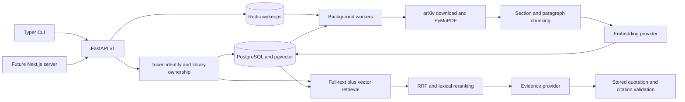

# Architecture

The API and CLI are transport layers over independent ingestion, retrieval, generation, and evaluation modules.
The CLI calls the API and never opens the database directly.

## Data and retrieval

Libraries have server-assigned owners and a recorded embedding-space fingerprint.
Documents are unique by library and source key: uploaded byte hash or versioned arXiv identifier.
Chunks are unique by document and ordinal, with title available through the document, page and section metadata, and a native `vector(n)` embedding.
Alembic creates the vector extension, foreign keys, uniqueness constraints, HNSW cosine index, and GIN full-text index.
The initial vector dimension comes from configuration and is checked by readiness after migration.

Retrieval runs within a library and owner filter before applying candidate limits.
The vector branch uses cosine distance and iterative HNSW scanning; the keyword branch uses PostgreSQL English full-text parsing and ranking.
The implementation follows [pgvector's filtered search guidance](https://github.com/pgvector/pgvector#iterative-index-scans) and [PostgreSQL's full-text controls](https://www.postgresql.org/docs/current/textsearch-controls.html).
Reciprocal rank fusion combines bounded lists using `sum(1 / (60 + rank))`.
The lexical reranker compares informative query terms with each candidate's text.
The API exposes both `retrieval_score` and the rerank/evidence `score`, which are not calibrated probabilities.
Only bounded candidates are loaded into Python; the application does not scan every stored embedding.

`embedding_space` protects against changing provider, model name, or dimensions within a library.
Model aliases can still change upstream; use pinned model identifiers for repeatable learned-embedding experiments.
This release uses application authorization and scoped SQL, not PostgreSQL row-level security.
Direct database credentials are privileged and must not be given to application clients.

## Jobs and recovery

The `jobs` table is a transactional outbox and authoritative queue.
Uploading stores a bounded file, commits the document and job together, then attempts a Redis wakeup.
Redis wakeup lists are capped and only serve as hints.
Workers poll due SQL jobs even when Redis is unavailable.
An upload interrupted before the database commit can leave an unreferenced local file; routine storage maintenance should compare files with stored document paths before removing anything.

`SELECT FOR UPDATE SKIP LOCKED` allows multiple workers to claim distinct jobs.
A claim increments attempts, assigns a unique lease token, and advances the lease deadline.
A heartbeat renews SQL leases independently of Redis availability.
Finalization locks the job and checks that the attempt still holds the lease token.
Chunk replacement and the completed status commit atomically, so a failed attempt cannot leave a ready document with partial chunks.
An expired worker's output is discarded once another worker holds the lease.

Transport failures, selected HTTP status codes, and transient database errors are retryable.
The default is three attempts with exponential delays.
Invalid PDFs and malformed model responses fail without consuming needless transport retries.
Safe error types are stored instead of exception strings that might include credentials.
The explicit retry endpoint creates a fresh job and preserves the failed record for inspection and metrics.

arXiv sync is an on-demand job accepting an identifier or search query and a limit of 20 papers.
It parses a bounded Atom feed with entity expansion disabled and only downloads PDFs from a fixed arXiv host.
A Redis gate spaces requests across workers, following the [arXiv API usage guidance](https://info.arxiv.org/help/api/user-manual.html).
Child PDF jobs are created in the parent's completion transaction.
Concurrent syncs serialize per-library deduplication.
Version suffixes remain part of the source key, so new paper revisions can coexist.
There is no periodic scheduler in this release; external scheduling can submit the same sync endpoint.

## Grounding contract

The evidence provider receives a JSON question and numbered source chunks.
Remote providers also receive a system message identifying source text as untrusted data.
The deterministic provider chooses a source sentence by lexical relevance.
Remote providers return a small structured list of source numbers and exact quotations.
The generation module accepts only complete sentences present in the referenced stored chunk and above the lexical evidence threshold.
It constructs all citation fields itself and returns no citations when any claim fails verification.

This contract prevents the API from presenting invented text as a verified source quote.
It does not establish truth, semantic sufficiency, or entailment for arbitrary research questions.
Future synthesis should be introduced as a separately evaluated generation policy with explicit entailment checks rather than silently weakening the quote validator.
Provider failures return an upstream error instead of being mislabeled as insufficient corpus evidence.

## Evaluation and observability

The corpus fixture has ten five-page PDFs, one fact and one question per page, plus ten unsupported questions.
Each retrieval mode is evaluated both before and after reranking.
Evaluation stores per-question gold IDs, retrieved IDs, emitted citation IDs, support decisions, and timings in PostgreSQL.
The checked-in report includes aggregate metrics and mismatched support decisions; complete cases remain available from the API.
Citation correctness checks document identity, library, title, page, and section.
Quote faithfulness checks that every emitted claim is textually present in its cited chunk.
Ingestion throughput is completed chunks divided by recorded processing time, excluding time queued.
Retry rate is the fraction of jobs requiring more than one attempt; manually resubmitted jobs retain their own records.

Structured logs use one request trace ID across API submission and ingestion, with timed span IDs for ingestion, embedding, retrieval, and generation.
Generation logs include provider-reported input and output token counts; extractive answers report zero.
No model credentials or document bodies are deliberately included in application stage logs.
Readiness verifies dependency connectivity, migration revision, embedding dimensions, and a recent worker heartbeat.
It does not call a paid model API or guarantee that an external model is loaded.

## Scaling boundaries

Increase ingestion concurrency with `docker compose up -d --scale worker=3`.
Workers share the upload volume and use row locks for safe claims.
Move shared files to object storage before distributing workers across hosts.
Use a reverse proxy, private database networking, managed credentials, per-user quotas, and a real identity provider before exposing this local stack as a hosted service.
Benchmark filtered HNSW recall and planner behavior on representative large libraries before changing index tuning or partitioning.
The current evaluation endpoint runs synchronously; large datasets and learned-model evaluations should move to their own background job type.
The recorded fixture timings do not establish a concurrency or capacity target.
